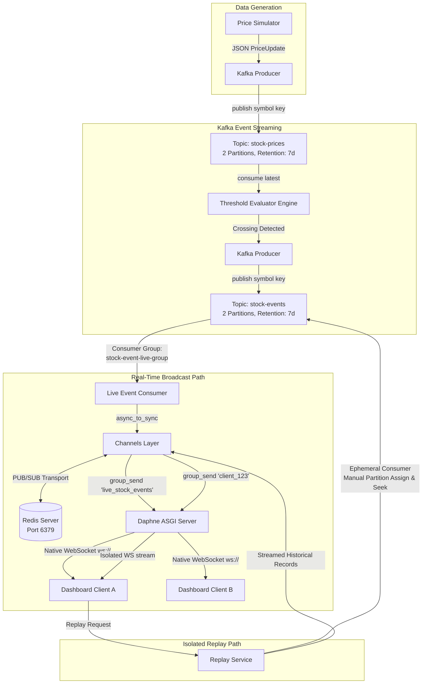

# System Architecture

## 1. Overview and High-Level Design

The **Real-Time Stock Event Capture and Replay System** is a distributed event-driven architecture designed to decouple high-frequency price data ingestion from complex event evaluation, durable event streaming, and stateful client notifications.

---

## 2. Component Breakdown & Boundaries

| Component | Technology | Primary Responsibility | Isolation Guarantee |
| :--- | :--- | :--- | :--- |
| **Price Simulator** | Python CLI / Process | Generates deterministic or random stock price ticks | Publishes raw prices only. Does NOT evaluate thresholds or trigger alerts. |
| **Ingress Topic (`stock-prices`)** | Apache Kafka 4.x | Retains simulated price log with 2 partitions | Partitioned by stock symbol (`AAPL`, `MSFT`) to guarantee FIFO ordering per stock. |
| **Threshold Evaluator** | Python / Kafka Consumer | Evaluates price crossing conditions with stateful hysteresis | Independent consumer group (`threshold-evaluator-group`). Emits events only upon true boundary crossings. |
| **Event Topic (`stock-events`)** | Apache Kafka 4.x | Retained log of captured business events | Single source of truth for both live delivery and historical replays. |
| **Live Event Consumer** | Python / Channels Layer | Reads captured events and forwards to Redis channel layer | Uses `stock-event-live-group`. Its offset advances monotonically as events are captured. |
| **Redis Channel Layer** | Redis 7.x (`channels_redis`) | In-memory message bus for Daphne ASGI workers | Ephemeral message routing between processes; not an event store. |
| **Replay Service** | Python / Ephemeral Kafka Consumer | Reads historical records from `stock-events` | Uses manual partition assignment (`assign()`) and `seek_to_beginning()`. Never touches live consumer offsets. |
| **ASGI Server & Consumers** | Django, Channels, Daphne | Manages WebSocket connections and channel groups | Separates broadcast group (`live_stock_events`) from private client group (`client_<id>`). |
| **Frontend Dashboard** | React 18, Vite, Native WebSockets | Visualizes live ticker, active alerts, and replayed events | Filterable UI with live indicators and client-side replay controls. |

---

## 3. Technology Role Matrix & Architectural Distinctions

### Kafka vs. Redis
- **Apache Kafka** is a **durable, immutable, partitioned distributed commit log**. Records in `stock-events` are written to disk and retained for 7 days according to policy. When a consumer reads records, the records remain in the log for other consumers and future replays.
- **Redis** is an **in-memory data structure store** used here strictly as the transport backend for `channels_redis`. Messages published to a Redis channel are transient: if a WebSocket worker is not actively listening, the message is not stored. Redis is never used as the event storage log.

### Kafka vs. WebSockets
- **Kafka** decouples decoupled backend services over a durable, partitioned log. It handles high-throughput, backpressure, and persistent replay.
- **WebSockets** provide a **full-duplex TCP transport** directly between the web server and browser client, enabling immediate push updates without client-side polling.

### Kafka Consumer vs. Django Channels Consumer
- **Kafka Consumer**: An operating system process or thread running a Kafka client loop (`poll()`), maintaining partition offsets against Kafka brokers.
- **Django Channels Consumer**: An asynchronous Python class (`AsyncWebsocketConsumer`) that manages the lifecycle of an individual browser WebSocket connection, listening to Redis channel-layer groups.

### Kafka Topic vs. Django Channels Group
- **Kafka Topic**: A durable, partitioned, disk-backed queue with offset tracking and configurable retention.
- **Channels Group**: An in-memory multicast group identifier in Redis (e.g., `live_stock_events`). Adding a channel name to a group allows broadcasting to all currently connected sockets in that group.

---

## 4. Replay Isolation Guarantee

A fundamental requirement of event-driven architectures is **offset isolation between live and historical processing**:

1. **Independent Group / Partition Assignment**:
   The `ReplayService` does not use the live group ID (`stock-event-live-group`). Instead, it uses **manual partition assignment** (`consumer.assign()`).
2. **Explicit Partition Seek**:
   The replay consumer explicitly queries watermarks and calls `consumer.seek_to_beginning()`. This resets only the ephemeral replay consumer's in-memory fetch pointer.
3. **Committed Offsets Unchanged**:
   The live consumer group's committed offsets in Kafka's `__consumer_offsets` topic are never modified by a replay request.
4. **No Side-Effects or Event Duplication**:
   Replaying historical records streams them over WebSockets with `delivery_mode="REPLAY"`. The evaluator is NOT invoked, and replayed events are NEVER republished into `stock-events`.
