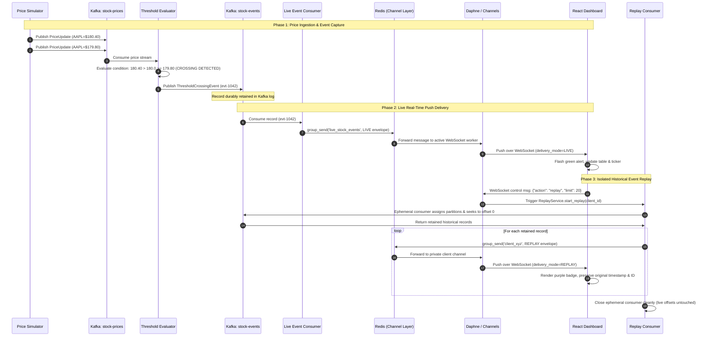

# End-to-End Event Lifecycle and Flow

This document details the exact sequence of events, data schemas, and state transitions for both live event processing and historical replay.

---

## 1. Sequence Diagram: Live Detection & Historical Replay



---

## 2. Step-by-Step 16-Stage Lifecycle

1. **Simulated Price Generation**:
   The `PriceSimulator` generates a deterministic or stochastic tick (e.g., AAPL: `$180.40` followed by `$179.80`).
2. **Publishing to Ingress Topic**:
   The simulator serializes a `PriceUpdate` payload and publishes it to `stock-prices` with key=`"AAPL"`.
3. **Consumption by Evaluator**:
   The `ThresholdEvaluator` running under group `threshold-evaluator-group` polls `stock-prices`.
4. **Threshold Evaluation & Hysteresis**:
   The evaluator compares current price `$179.80` against previous observation `$180.40` for rule `AAPL <= 180.00`. It detects a downward crossing condition:
   $$\text{previous\_price} > \text{threshold} \quad \land \quad \text{current\_price} \le \text{threshold}$$
5. **Event Generation**:
   A unique `event_id` (`evt-xxxxx`) is assigned with a UTC ISO-8601 timestamp.
6. **Publishing to Egress Topic**:
   The evaluator publishes the structured `ThresholdCrossingEvent` to the durable `stock-events` Kafka topic with key=`"AAPL"`.
7. **Durable Log Retention**:
   Apache Kafka writes the record to disk in the assigned partition log (`/opt/kafka/data/stock-events-0/`). Kafka retains the record according to topic policy (`retention.ms=604800000` / 7 days).
8. **Live Consumption**:
   The dedicated `LiveEventConsumer` reads the new record using consumer group `stock-event-live-group` and commits its offset.
9. **Dispatch to Channel Layer**:
   The live consumer uses `async_to_sync(channel_layer.group_send)` to broadcast the event to group `"live_stock_events"`.
10. **Redis Transport**:
    The `channels_redis` backend distributes the message through Redis to all active Daphne worker threads.
11. **WebSocket Transmission**:
    The ASGI `StockEventsConsumer` receives the channel message and pushes JSON to the browser socket.
12. **Frontend Presentation**:
    The React dashboard receives the message, adds it to the active feed, highlights the price card, and renders a green `LIVE` badge.
13. **Replay Trigger**:
    The user clicks **"Replay Events from Kafka"** on the dashboard.
14. **Isolated Partition Seek**:
    The `ReplayService` spawns an isolated background worker with an ephemeral consumer, calls `consumer.assign()` across all partitions of `stock-events`, and invokes `seek_to_beginning()`.
15. **Targeted Replay Dispatch**:
    The worker reads historical events, marks their delivery envelope with `delivery_mode="REPLAY"` and a unique `replay_id`, preserving original `event_id` and `event_timestamp`, and dispatches them directly to the client's private group `client_<id>`.
16. **Frontend Replay Visualization**:
    The dashboard receives the stream with a paced animation, displaying the historical event with a purple `REPLAY` badge and showing original event creation times alongside replay receipt timestamps.

---

## 3. Data Schema Evolution

### A. Raw Ingress Price Update (`stock-prices`)
```json
{
  "message_id": "price-4f9a12bc",
  "symbol": "AAPL",
  "price": 179.80,
  "observed_at": "2026-10-22T08:35:10.123456Z"
}
```

### B. Captured Business Event (`stock-events`)
```json
{
  "event_id": "evt-7a8b9c0d",
  "event_type": "PRICE_THRESHOLD_CROSSED",
  "symbol": "AAPL",
  "previous_price": 180.40,
  "price": 179.80,
  "threshold": 180.00,
  "condition": "LESS_THAN_OR_EQUAL",
  "event_timestamp": "2026-10-22T08:35:10.125000Z",
  "processing_mode": "LIVE"
}
```

### C. WebSocket Live Envelope Delivered to Browser
```json
{
  "message_type": "stock_event",
  "delivery_mode": "LIVE",
  "event": {
    "event_id": "evt-7a8b9c0d",
    "event_type": "PRICE_THRESHOLD_CROSSED",
    "symbol": "AAPL",
    "previous_price": 180.40,
    "price": 179.80,
    "threshold": 180.00,
    "condition": "LESS_THAN_OR_EQUAL",
    "event_timestamp": "2026-10-22T08:35:10.125000Z"
  },
  "details": {
    "kafka_partition": 0,
    "kafka_offset": 42
  }
}
```

### D. WebSocket Historical Replay Envelope Delivered to Browser
```json
{
  "message_type": "stock_event",
  "delivery_mode": "REPLAY",
  "replay_id": "replay-9e12f45a",
  "event": {
    "event_id": "evt-7a8b9c0d",
    "event_type": "PRICE_THRESHOLD_CROSSED",
    "symbol": "AAPL",
    "previous_price": 180.40,
    "price": 179.80,
    "threshold": 180.00,
    "condition": "LESS_THAN_OR_EQUAL",
    "event_timestamp": "2026-10-22T08:35:10.125000Z"
  },
  "details": {
    "original_partition": 0,
    "original_offset": 42,
    "replayed_at": "2026-10-22T08:45:00.000000Z"
  }
}
```
Notice that:
- `event_id` is identical (`evt-7a8b9c0d`).
- `event_timestamp` is strictly preserved (`2026-10-22T08:35:10.125000Z`).
- `delivery_mode` clearly identifies `"REPLAY"`.
- `replay_id` links the record to the initiating user request.
